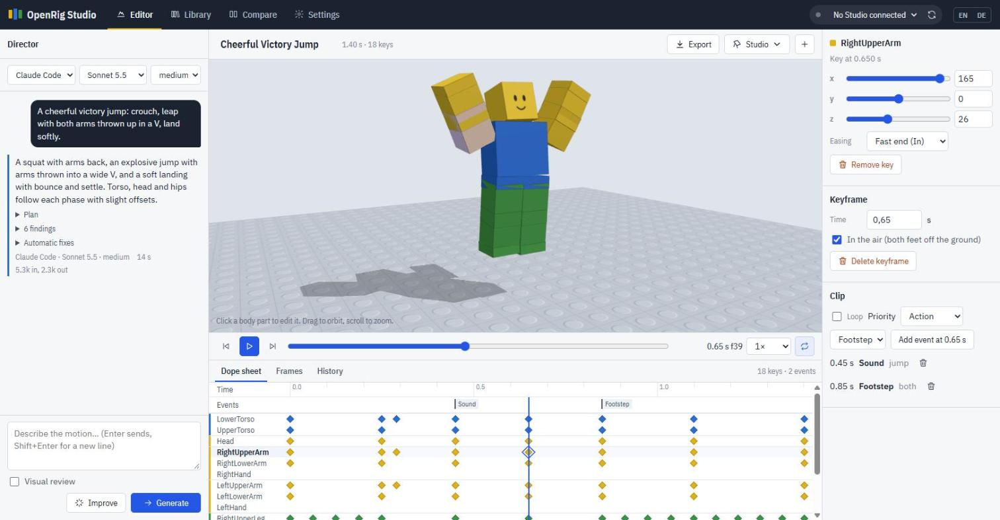

# OpenRig Studio

Generate Roblox R15 animations with the AI you already pay for. Describe a motion, watch it on a 3D rig, tweak keyframes, compare models side by side and send the result straight into Roblox Studio. Free and open source.



- **Use your own AI.** Claude Code and the Codex CLI run on your existing Claude or ChatGPT subscription. Anthropic and OpenAI API keys work too. No accounts, no credits, nothing in between.
- **Pick the model and effort** for every request, from fast and cheap to slow and thorough.
- **Preview that matches Roblox.** The playback math was measured against Roblox Studio, including its easing and rotation blending quirks.
- **Built-in animation rules.** Hand and foot targets (IK), planted feet that don't slide, automatic grounding, spins and flips, and checks for snapping joints or limbs inside the body.
- **Visual review.** Optionally the model looks at a contact sheet of its own draft and fixes what it sees.
- **Compare models.** One prompt, several models, results play in sync.
- **Library.** Folders, search, rename, star, bulk export, bulk send to Studio.
- **Roblox Studio bridge.** Send clips to Studio, play them on a preview rig or on your avatar in a playtest, and import versions you refined in the Animation Editor.

## Quick start

You need [Node.js](https://nodejs.org) 20 or newer and at least one AI provider:

| Provider | What you need |
|---|---|
| Claude Code | [Claude Code](https://claude.com/claude-code) installed. Run `claude` once in a terminal and log in with your Claude subscription. |
| Codex CLI | The [Codex CLI](https://github.com/openai/codex) installed. Run `codex` once and log in with your ChatGPT subscription. |
| Anthropic API | An API key from console.anthropic.com |
| OpenAI API | An API key from platform.openai.com |

```sh
git clone https://github.com/<you>/openrig-studio.git
cd openrig-studio
npm install        # only needed for API keys
npm start          # or double-click start.cmd (Windows) / run ./start.sh (macOS, Linux)
```

Open <http://localhost:4330>. The Settings tab shows which providers were found and is where you paste API keys. Keys are stored only on your computer in `data/settings.json`; you can also put them in a `.env` file (see `.env.example`).

## Working with Roblox Studio

OpenRig Studio talks to Roblox Studio through the MCP server that ships with Studio. Open your place in Studio, pick it in the top bar, then use the **Studio** menu:

- **Send to Studio** saves the clip under `ServerStorage › RBX_ANIMSAVES` and places a preview rig in front of your Studio camera. Open the Animation Editor, select the rig and use **Load** to refine or **Publish to Roblox** to get an asset id.
- **Play in Studio** plays the clip on the preview rig in edit mode.
- **Play on my avatar** plays it on your character during a playtest (F5). The playtest avatar must be R15.
- **Import from Studio** brings a version you edited in the Animation Editor back as the newest version of the clip.

Without the bridge you can still **Export › Download .rbxmx** and use *Insert from File* in Studio, or copy a Luau snippet that builds the KeyframeSequence.

If no Studio window shows up, keep the place open and check that Roblox Studio's built-in MCP server is available; on unusual installs set the path to `StudioMCP` in Settings.

## How it works

1. Your request goes to the chosen model together with a system prompt (`prompts/system.md`) that teaches the R15 rig: axes, landmarks, reach, joint limits, tested poses, timing and easing rules.
2. The model answers with keyframes as JSON, optionally using hand and foot targets instead of angles.
3. The pipeline normalises the clip, splits large rotations, solves IK, plants feet, puts the body on the ground, smooths easing on pass-through keys and checks for problems.
4. With visual review on, a contact sheet of the draft goes back to the model for a second pass.
5. Every result is kept in the clip's history, so you can go back at any time.

Details and the Roblox measurements behind the preview: [docs/how-it-works.md](docs/how-it-works.md).

## Project layout

```
prompts/            system prompt and presets (edit these to tune results)
src/core/           rig, animation pipeline, IK, renderer (no dependencies)
src/server/         local web server, providers, library, Studio bridge
web/                the browser app (plain ES modules, three.js from a CDN)
test/               node --test suite with Roblox reference values
data/               your clips and settings (created on first start, not in git)
```

Run the tests with `npm test`.

## Privacy

Everything runs locally. Prompts and clip data are sent only to the AI provider you pick for a request. API keys never leave your machine except in requests to their own provider.

## License

MIT, see [LICENSE](LICENSE).

---

## Kurz auf Deutsch

OpenRig Studio erzeugt Roblox-R15-Animationen mit den KI-Abos, die du schon hast (Claude Code, Codex CLI) oder mit API-Keys. Node.js 20+ installieren, Repo klonen, `npm start` ausführen bzw. `start.cmd` doppelklicken und <http://localhost:4330> öffnen. In den Einstellungen siehst du, welche Anbieter gefunden wurden; oben rechts schaltest du die Oberfläche auf Deutsch um.
